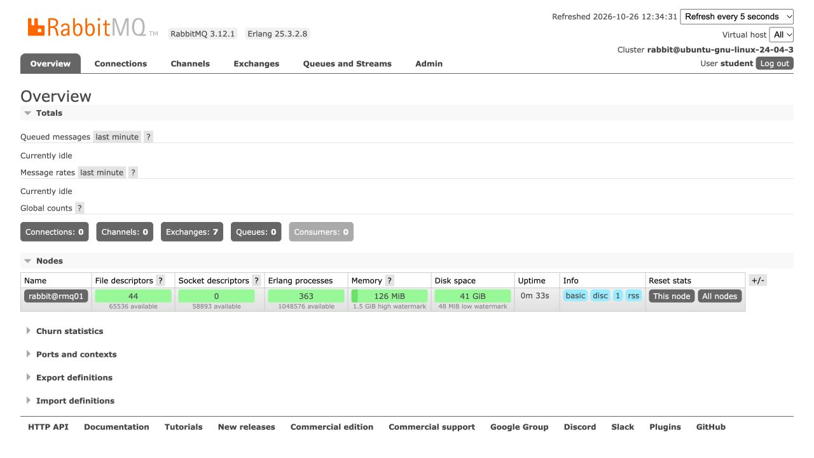
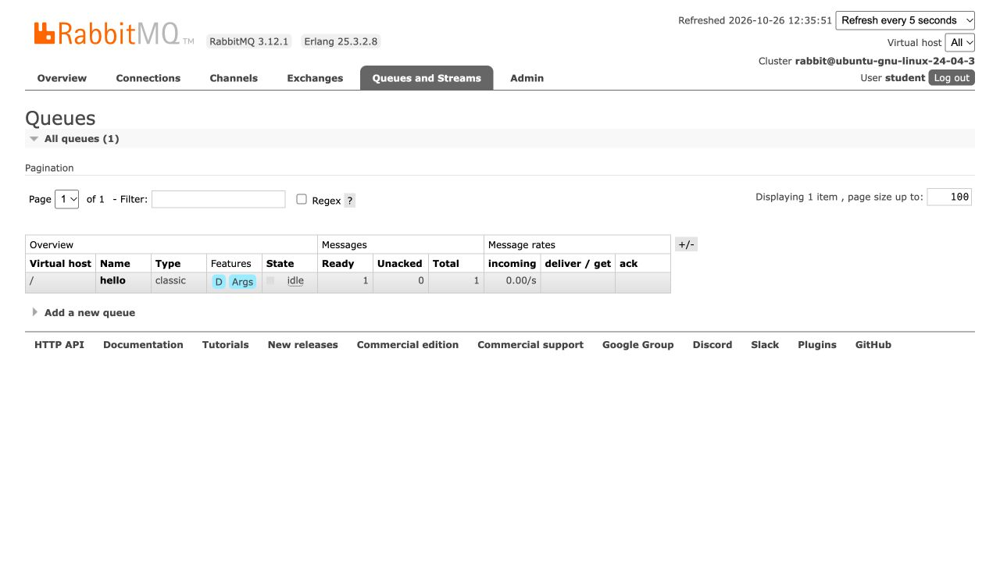
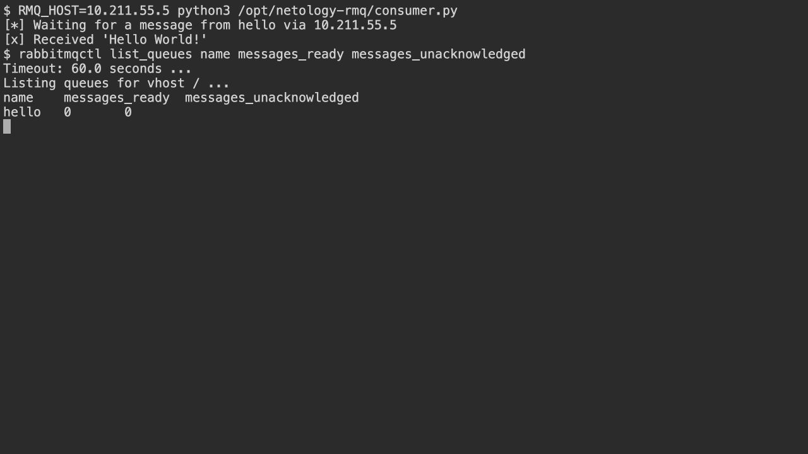
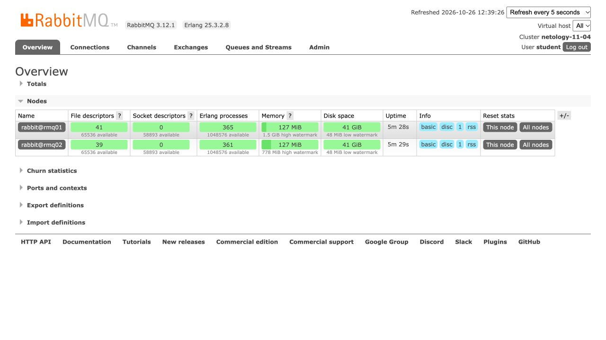
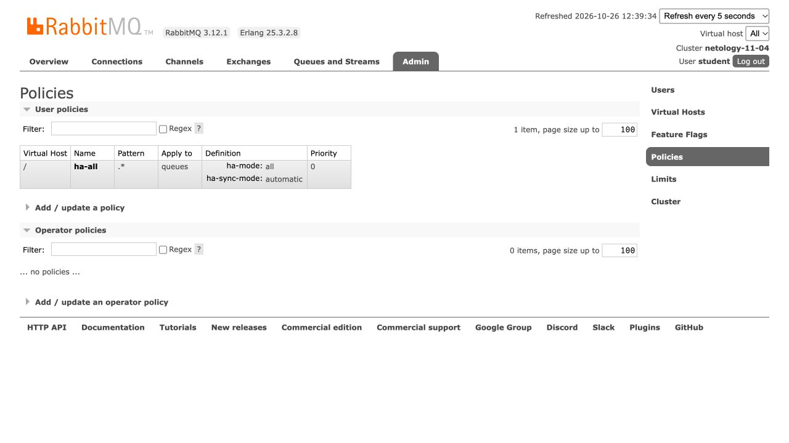
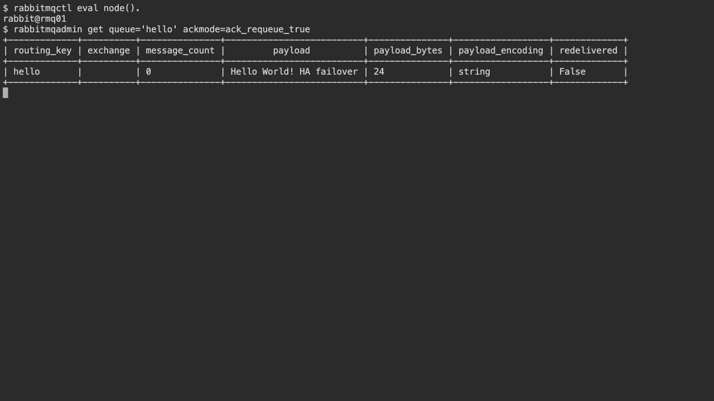

# Домашнее задание «Очереди RabbitMQ»

**Студент: Андрей Степанов**  
**Дата выполнения: 26 октября 2026 года**

[Условия задания](https://github.com/netology-code/sdb-homeworks/blob/main/11-04.md)

## Среда выполнения

Работа выполнена на двух отдельных виртуальных машинах Ubuntu 24.04.4 LTS ARM64 в Parallels Desktop. В исходном задании указаны Vagrant или VirtualBox; фактически использован Parallels. Согласование этой замены с преподавателем не проводилось.

| Параметр | Первая нода | Вторая нода |
|---|---|---|
| Виртуальная машина | Ubuntu 24.04.3 ARM64 | netology-rmq02 |
| Имя ноды RabbitMQ | rabbit@rmq01 | rabbit@rmq02 |
| IP-адрес | 10.211.55.5 | 10.211.55.6 |
| CPU / RAM | 2 / 4 ГБ | 2 / 2 ГБ |
| ОС | Ubuntu 24.04.4 LTS ARM64 | Ubuntu 24.04.4 LTS ARM64 |
| RabbitMQ | 3.12.1, пакет 3.12.1-1ubuntu1.7 | 3.12.1, пакет 3.12.1-1ubuntu1.7 |
| Erlang / Pika | 25.3.2.8 / 1.2.0 | 25.3.2.8 / 1.2.0 |

Обе ВМ находятся в общей сети Parallels Shared Network. RabbitMQ установлен непосредственно в гостевых ОС пакетами Ubuntu. Вторая ВМ создана клонированием первой до отправки сообщений. У ВМ разные MAC-адреса и IP, у брокеров разные имена нод.

Для выполнения политики `ha-all` выбран RabbitMQ 3.x: зеркалирование классических очередей удалено в RabbitMQ 4.0. В современных системах применяются quorum queues или streams. Здесь используется classic queue, чтобы воспроизвести именно требуемый в задании механизм. [Документация о зеркалировании](https://www.rabbitmq.com/docs/3.13/ha).

## Задание 1. Установка RabbitMQ

На обеих машинах выполнена установка:

```bash
sudo apt-get update
sudo apt-get install -y rabbitmq-server python3-pika curl
```

Заданы имена нод в `/etc/rabbitmq/rabbitmq-env.conf`:

```ini
# Первая ВМ
NODENAME=rabbit@rmq01
```

```ini
# Вторая ВМ
NODENAME=rabbit@rmq02
```

Включён плагин управления:

```bash
sudo rabbitmq-plugins enable rabbitmq_management
sudo chown rabbitmq:rabbitmq /etc/rabbitmq/enabled_plugins
sudo chmod 644 /etc/rabbitmq/enabled_plugins
sudo systemctl enable rabbitmq-server
sudo systemctl restart rabbitmq-server
sudo rabbitmq-diagnostics -q ping
```

Создан отдельный учебный пользователь `student` с правами на виртуальный хост `/` и тегом `administrator`. Пароль не включён в репозиторий. Веб-интерфейс открыт по адресу `http://10.211.55.5:15672`.



**Результат:** RabbitMQ 3.12.1 запущен, management plug-in работает, вход в веб-интерфейс выполнен.

## Задание 2. Отправка и получение сообщений

Подготовлены скрипты [producer.py](producer.py) и [consumer.py](consumer.py) на Python 3 с библиотекой Pika. Пример взаимодействия основан на [официальном руководстве RabbitMQ](https://www.rabbitmq.com/tutorials/tutorial-one-python). Скрипты адаптированы к classic queue и учётным данным учебного стенда.

Установка Pika на стенде выполнена через пакет `python3-pika`. Альтернативный способ для отдельного виртуального окружения:

```bash
python3 -m venv .venv
. .venv/bin/activate
python3 -m pip install -r requirements.txt
```

Перед запуском задаются параметры соединения. Переменная `RMQ_PASSWORD` должна содержать пароль созданного пользователя:

```bash
export RMQ_HOST=10.211.55.5
export RMQ_USER=student
read -rs -p 'RabbitMQ password: ' RMQ_PASSWORD; echo
export RMQ_PASSWORD
python3 producer.py
```

Producer объявляет durable classic queue `hello`, публикует persistent-сообщение `Hello World!` через default exchange и ожидает publisher confirm. После отправки получен результат:

```text
[x] Sent 'Hello World!' to hello via 10.211.55.5
name    messages_ready    messages_unacknowledged
hello   1                 0
```



Затем выполнен `python3 consumer.py`. Consumer получил сообщение и отправил подтверждение `basic_ack`:

```text
[*] Waiting for a message from hello via 10.211.55.5
[x] Received 'Hello World!'
```



**Результат:** сообщение отправлено и получено; после подтверждения в очереди `Ready = 0`, `Unacked = 0`.

Исходные журналы: [producer](logs/02-producer.txt), [consumer](logs/02-consumer.txt). Терминальные скриншоты в этом отчёте показывают сохранённый вывод реальных запусков через терминал только для чтения; вывод дополнительно приложен в исходных `.txt` файлах.

## Задание 3. Подготовка HA-кластера

### Разрешение имён и объединение нод

На обеих машинах в `/etc/hosts` добавлены записи:

```text
10.211.55.5 rmq01
10.211.55.6 rmq02
```

Проверены разрешение имён и связь `ping -c 2 rmq01` со второй ВМ. Поскольку ВМ клонированы после установки RabbitMQ, у них изначально одинаковый Erlang cookie. При независимой установке необходимо безопасно скопировать `/var/lib/rabbitmq/.erlang.cookie` с первой ноды на вторую при остановленном сервисе, установить владельца `rabbitmq:rabbitmq` и права `400`. Значение cookie в репозиторий не включается.

На второй ноде выполнены команды:

```bash
sudo rabbitmqctl stop_app
sudo rabbitmqctl join_cluster rabbit@rmq01
sudo rabbitmqctl start_app
```

[Полный журнал объединения](logs/03-cluster-join.txt).

Кластер получил имя `netology-11-04`. Обе ноды доступны в веб-интерфейсе:



### Политика ha-all

На первой ноде выполнено:

```bash
sudo rabbitmqctl set_cluster_name netology-11-04
sudo rabbitmqctl set_policy ha-all '.*' \
  '{"ha-mode":"all","ha-sync-mode":"automatic"}' \
  --priority 0 --apply-to queues
sudo rabbitmqctl sync_queue hello
sudo rabbitmqctl list_policies
sudo rabbitmqctl list_queues name policy pid slave_pids synchronised_slave_pids
```

Политика применяется ко всем очередям виртуального хоста `/`. Для `hello` получено зеркало на `rabbit@rmq02`; эта же нода присутствует в `synchronised_slave_pids`, то есть зеркало синхронизировано.



[Журнал настройки политики и синхронизации](logs/03-policy.txt).

### Вывод rabbitmqctl cluster_status с обеих нод

Полные результаты представлены ниже и отдельными файлами: [rmq01](logs/03-cluster-status-rmq01.txt), [rmq02](logs/03-cluster-status-rmq02.txt).

<details>
<summary>Полный cluster_status: rmq01</summary>

```text
$ rabbitmqctl cluster_status
Cluster status of node rabbit@rmq01 ...
Basics

Cluster name: netology-11-04
Total CPU cores available cluster-wide: 4

Disk Nodes

rabbit@rmq01
rabbit@rmq02

Running Nodes

rabbit@rmq01
rabbit@rmq02

Versions

rabbit@rmq01: RabbitMQ 3.12.1 on Erlang 25.3.2.8
rabbit@rmq02: RabbitMQ 3.12.1 on Erlang 25.3.2.8

CPU Cores

Node: rabbit@rmq01, available CPU cores: 2
Node: rabbit@rmq02, available CPU cores: 2

Maintenance status

Node: rabbit@rmq01, status: not under maintenance
Node: rabbit@rmq02, status: not under maintenance

Alarms

(none)

Network Partitions

(none)

Listeners

Node: rabbit@rmq01, interface: [::], port: 15672, protocol: http, purpose: HTTP API
Node: rabbit@rmq01, interface: [::], port: 25672, protocol: clustering, purpose: inter-node and CLI tool communication
Node: rabbit@rmq01, interface: [::], port: 5672, protocol: amqp, purpose: AMQP 0-9-1 and AMQP 1.0
Node: rabbit@rmq02, interface: [::], port: 15672, protocol: http, purpose: HTTP API
Node: rabbit@rmq02, interface: [::], port: 25672, protocol: clustering, purpose: inter-node and CLI tool communication
Node: rabbit@rmq02, interface: [::], port: 5672, protocol: amqp, purpose: AMQP 0-9-1 and AMQP 1.0

Feature flags

Flag: classic_mirrored_queue_version, state: enabled
Flag: classic_queue_type_delivery_support, state: enabled
Flag: direct_exchange_routing_v2, state: enabled
Flag: drop_unroutable_metric, state: enabled
Flag: empty_basic_get_metric, state: enabled
Flag: feature_flags_v2, state: enabled
Flag: implicit_default_bindings, state: enabled
Flag: listener_records_in_ets, state: enabled
Flag: maintenance_mode_status, state: enabled
Flag: quorum_queue, state: enabled
Flag: restart_streams, state: enabled
Flag: stream_queue, state: enabled
Flag: stream_sac_coordinator_unblock_group, state: enabled
Flag: stream_single_active_consumer, state: enabled
Flag: tracking_records_in_ets, state: enabled
Flag: user_limits, state: enabled
Flag: virtual_host_metadata, state: enabled
```

</details>

<details>
<summary>Полный cluster_status: rmq02</summary>

```text
$ rabbitmqctl cluster_status
Cluster status of node rabbit@rmq02 ...
Basics

Cluster name: netology-11-04
Total CPU cores available cluster-wide: 4

Disk Nodes

rabbit@rmq01
rabbit@rmq02

Running Nodes

rabbit@rmq01
rabbit@rmq02

Versions

rabbit@rmq01: RabbitMQ 3.12.1 on Erlang 25.3.2.8
rabbit@rmq02: RabbitMQ 3.12.1 on Erlang 25.3.2.8

CPU Cores

Node: rabbit@rmq01, available CPU cores: 2
Node: rabbit@rmq02, available CPU cores: 2

Maintenance status

Node: rabbit@rmq01, status: not under maintenance
Node: rabbit@rmq02, status: not under maintenance

Alarms

(none)

Network Partitions

(none)

Listeners

Node: rabbit@rmq01, interface: [::], port: 15672, protocol: http, purpose: HTTP API
Node: rabbit@rmq01, interface: [::], port: 25672, protocol: clustering, purpose: inter-node and CLI tool communication
Node: rabbit@rmq01, interface: [::], port: 5672, protocol: amqp, purpose: AMQP 0-9-1 and AMQP 1.0
Node: rabbit@rmq02, interface: [::], port: 15672, protocol: http, purpose: HTTP API
Node: rabbit@rmq02, interface: [::], port: 25672, protocol: clustering, purpose: inter-node and CLI tool communication
Node: rabbit@rmq02, interface: [::], port: 5672, protocol: amqp, purpose: AMQP 0-9-1 and AMQP 1.0

Feature flags

Flag: classic_mirrored_queue_version, state: enabled
Flag: classic_queue_type_delivery_support, state: enabled
Flag: direct_exchange_routing_v2, state: enabled
Flag: drop_unroutable_metric, state: enabled
Flag: empty_basic_get_metric, state: enabled
Flag: feature_flags_v2, state: enabled
Flag: implicit_default_bindings, state: enabled
Flag: listener_records_in_ets, state: enabled
Flag: maintenance_mode_status, state: enabled
Flag: quorum_queue, state: enabled
Flag: restart_streams, state: enabled
Flag: stream_queue, state: enabled
Flag: stream_sac_coordinator_unblock_group, state: enabled
Flag: stream_single_active_consumer, state: enabled
Flag: tracking_records_in_ets, state: enabled
Flag: user_limits, state: enabled
Flag: virtual_host_metadata, state: enabled
```

</details>

### Чтение очереди на каждой ноде

Повторно запущен producer с сообщением `Hello World! HA failover` и подключением к первой ноде:

```bash
RMQ_HOST=10.211.55.5 RMQ_MESSAGE='Hello World! HA failover' python3 producer.py
```

Подтверждено: в очереди одно готовое сообщение, зеркало синхронизировано. [Журнал отправки](logs/03-ha-producer.txt).

На каждой ноде выполнена команда:

```bash
rabbitmqadmin get queue='hello' ackmode=ack_requeue_true
```

Параметр `ackmode=ack_requeue_true` возвращает прочитанное сообщение в очередь, чтобы оно сохранилось для последующей проверки отказоустойчивости. Поле `message_count = 0` в ответе get показывает число остальных сообщений в момент выдачи, а не результат после возврата текущего сообщения в очередь. При повторном чтении на второй ноде `redelivered = True`.




Исходные журналы: [rmq01](logs/03-get-rmq01.txt), [rmq02](logs/03-get-rmq02.txt).

### Проверка отказоустойчивости

На первой ВМ остановлен сервис RabbitMQ, то есть отключена нода `rabbit@rmq01`. ОС первой ВМ осталась включена и использовалась как клиент для подключения ко второму брокеру:

```bash
sudo systemctl stop rabbitmq-server
sudo systemctl is-active rabbitmq-server
# inactive
RMQ_HOST=10.211.55.6 python3 consumer.py
```

Получен результат:

```text
[*] Waiting for a message from hello via 10.211.55.6
[x] Received 'Hello World! HA failover'
```


Во время проверки команда `rabbitmqctl cluster_status` на второй ноде показывала только `rabbit@rmq02` в разделе `Running Nodes`. [Статус во время отказа](logs/03-cluster-during-failover.txt), [результат consumer](logs/03-failover-consumer.txt).

**Результат:** синхронизированное зеркало стало ведущей репликой, сообщение сохранилось и было получено через вторую ноду после остановки первой.

После проверки первая нода запущена обратно. Обе ноды работают; ведущая реплика `hello` находится на `rabbit@rmq02`, синхронизированное зеркало — на `rabbit@rmq01`. После обработки сообщения очередь пуста, неподтверждённых сообщений нет. [Восстановленный кластер](logs/03-cluster-restored.txt), [финальная проверка](logs/03-final-check.txt).

Это проверка остановки одного брокера учебного кластера. Поведение при сетевом разделении, одновременном отказе обеих ВМ и отказе физического Mac в данном эксперименте не проверялось.

## Состав решения

- `README.md` — отчёт по обязательным заданиям 1–3.
- `producer.py`, `consumer.py`, `requirements.txt` — скрипты и версия Pika.
- `screenshots/` — скриншоты веб-интерфейса и вывода команд.
- `logs/` — полные журналы фактического выполнения.

Дополнительное задание 4 с Ansible не выполнялось.
